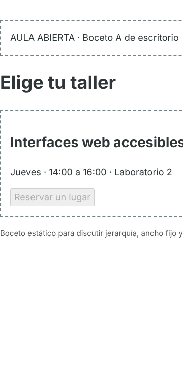
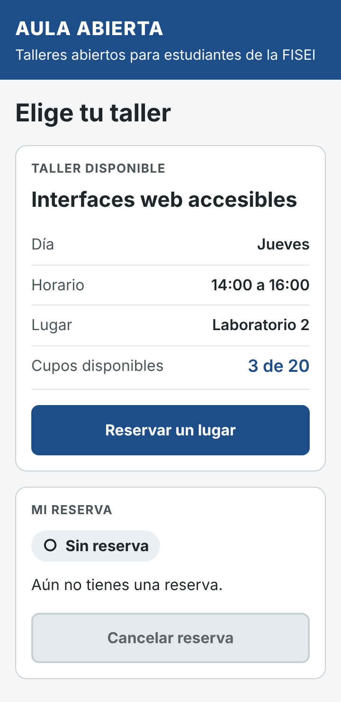
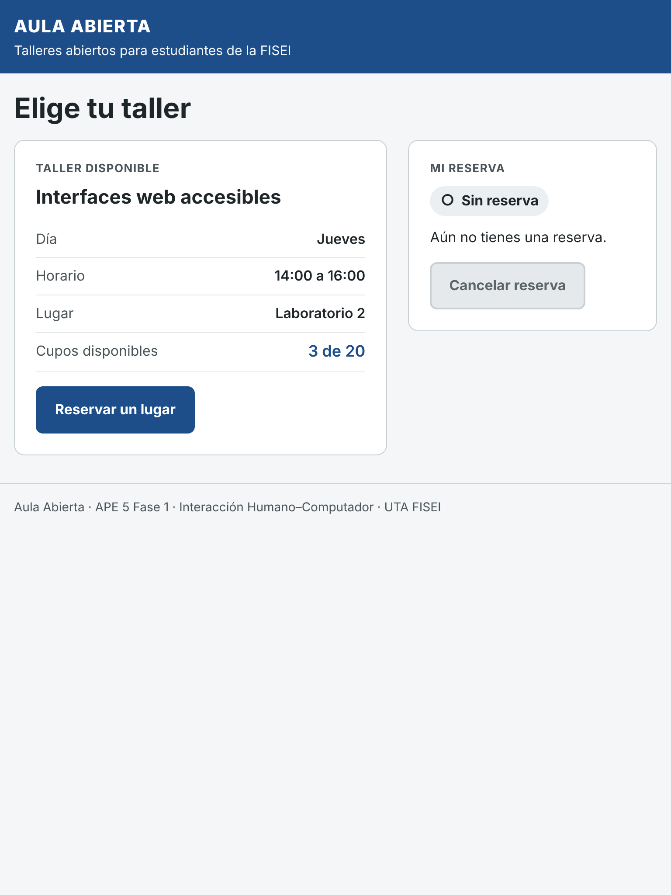
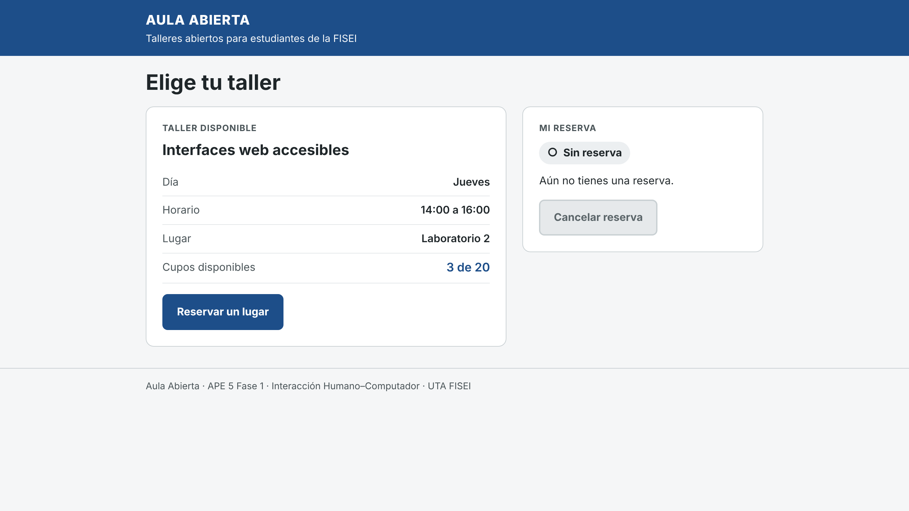
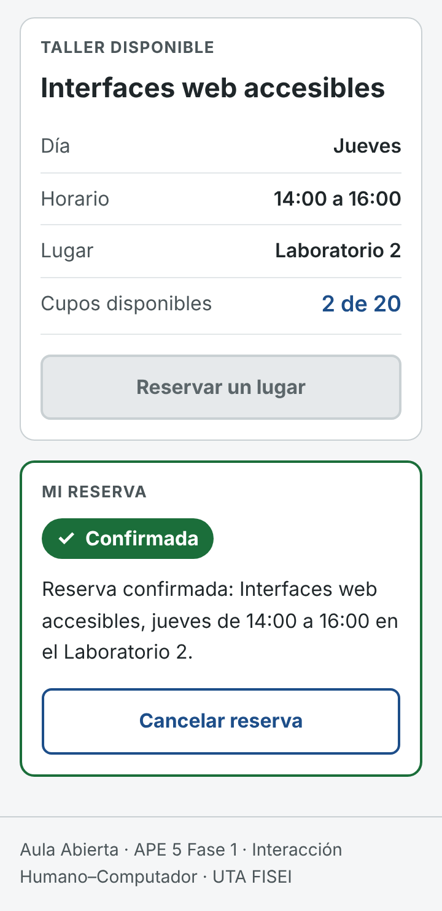
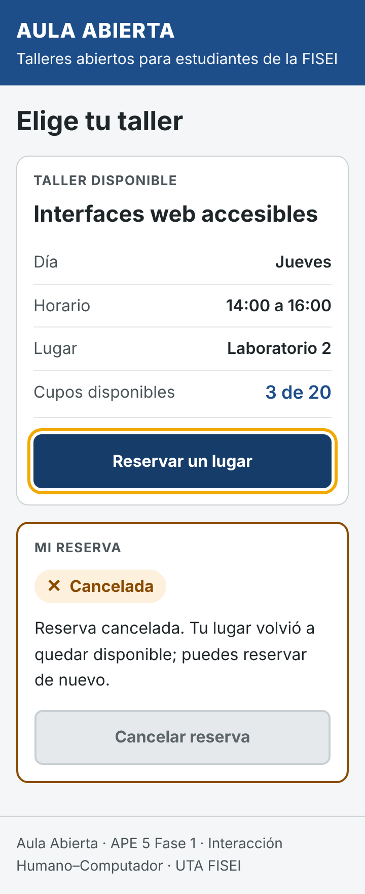

# APE 5 · Del boceto a la interfaz web adaptable — Grupo 2

🔗 **Ver en vivo:** https://zzzheyla.github.io/APE5_HCI_GRUPO2/

Repositorio del **Grupo 2** para las dos fases del APE 5 de Interacción Humano–Computador.

| Fase | Contenido | Estado |
|---|---|---|
| **Fase 1** | Diagnóstico, ficha, HTML5 semántico, CSS Mobile First y estados de interacción | ✅ Completa |
| **Fase 2** | Validación de la hipótesis y mejoras | ⏳ En desarrollo |

---

## FASE 1

Transformación del **Boceto A de escritorio** («Aula Abierta · Elige tu taller») en una interfaz web adaptable con **HTML5 semántico**, **CSS Mobile First** (punto de corte en `48rem` / 768 px) y **estados de acción y cancelación accesibles por teclado**.

**Asignatura:** Interacción Humano–Computador · UTA FISEI · 5.º Software «B»

## Estructura del repositorio

```
├── index.html             → redirige a src/ (para GitHub Pages)
├── docs/
│   └── proyecto.md        → Fase 1: ficha, regla de negocio, decisión HCI e hipótesis
├── prototipos/
│   └── prototipo-A.html   → boceto original (sin cambios)
├── src/
│   ├── index.html         → estructura HTML5 semántica
│   ├── estilos.css        → CSS Mobile First
│   └── reserva.js         → estados Disponible → Confirmada → Cancelada
└── evidencias/
    ├── fase1/             → capturas ANTES y DESPUÉS
    └── fase2/             → evidencias de la Fase 2
```

## 1. Diagnóstico del Boceto A (360 px)

| Medición a 360 px | Boceto A | Versión adaptable |
|---|---|---|
| Ancho de la página | **960 px** (600 px de desborde) | **360 px** |
| Panel «Mi reserva» | Empieza en x = 600 px: **fuera de la pantalla** | Debajo del taller, visible en la primera pantalla |
| Tarjeta del taller | 580 px: **se corta** | Ocupa el ancho disponible |

**Qué se pierde:** el **panel de estado «Mi reserva»** queda completamente fuera de la vista, así que el estudiante no puede saber si su reserva se confirmó. La causa son los anchos fijos `body { width: 960px }` y `grid-template-columns: 580px 360px`.

| Antes (360 px) | Después (360 px) |
|---|---|
|  |  |

## 2. Ficha de aplicación

Actor → Tarea → Dato decisivo → Acción principal → Estado final, con la regla de negocio y el criterio de aceptación medible, en **[docs/proyecto.md](docs/proyecto.md)**.

## 3. HTML5 semántico (`src/index.html`)

- `header`, `main`, `section` (taller y mi reserva), `article` (el taller) y `footer`.
- `<dl>` para los datos del taller (día, horario, lugar y **cupos disponibles**, que es el dato decisivo).
- Controles nativos `<button>`, navegables con Tab.
- `<p role="status">` comunica cada cambio de estado al lector de pantalla.
- **Orden de lectura:** taller → acción → estado. El CSS no lo altera.

## 4. CSS Mobile First (`src/estilos.css`)

```css
.distribucion { display: grid; grid-template-columns: 1fr; }        /* móvil: 1 columna */

@media (min-width: 48rem) {                                          /* ≥ 768 px */
  .distribucion { grid-template-columns: minmax(0, 3fr) minmax(0, 2fr); }
}
```

Desde 768 px caben el taller (≈ 430 px) y el panel de estado (≈ 290 px) lado a lado sin comprimir el texto, y el estado queda junto a la acción. No se usa `order` ni `grid-area` para reordenar, así que el orden visual coincide con el del HTML.

| 768 px | 1366 px |
|---|---|
|  |  |

## 5. Estados de interacción (`src/reserva.js`)

| Estado | Reservar | Cancelar | Foco | Cupos |
|---|---|---|---|---|
| **Disponible** | activo | `disabled` | — | 3 |
| **Confirmada** | `disabled` (sin duplicados) | activo | pasa a **Cancelar** | 2 |
| **Cancelada** | activo | `disabled` | vuelve a **Reservar** | 3 |

Cada estado se muestra con **ícono + texto + color** (○ Sin reserva, ✓ Confirmada, ✕ Cancelada) y se anuncia con `role="status"`.

| Confirmada (360 px) | Cancelada (360 px) |
|---|---|
|  |  |

## Pruebas realizadas

- Sin desplazamiento horizontal a 360, 768 y 1366 px (`scrollWidth` igual al ancho de la pantalla).
- 5 clics seguidos en «Reservar»: 1 sola reserva y los cupos bajan solo de 3 a 2.
- Tarea completa con teclado: Tab hasta «Reservar», Enter, el foco pasa a «Cancelar», Enter, y el foco vuelve a «Reservar».

## Cómo ejecutar

Abrir `src/index.html` en el navegador. No requiere instalación.

## Hipótesis para la Fase 2

Ver la sección 6 de [docs/proyecto.md](docs/proyecto.md).

---

## FASE 2

*En desarrollo.*

## Integrantes

- Pacha Lucintuña Sheyla Eliana · Fase 1
- Palacios Vaca Martín Sebastián · Fase 2
- Pérez Alvarez David Alexander · Fase 2
